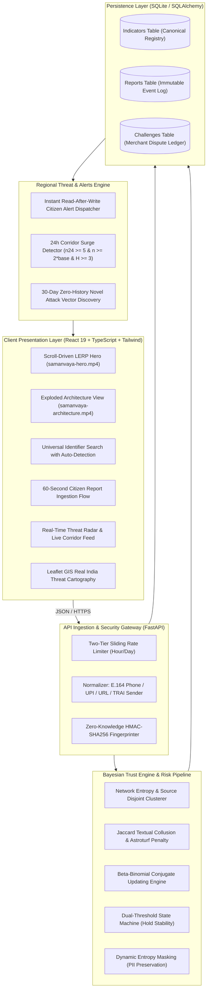

<div align="center">

# SAMANVAYA
### Community-Powered Cyber Scam Intelligence Platform
**"Know before you trust."**

*Community-powered intelligence for safer digital interactions across India's digital payments and telecommunications ecosystem.*

[](https://fastapi.tiangolo.com)
[](https://react.dev)
[](https://www.typescriptlang.org)
[](https://tailwindcss.com)
[](https://www.python.org)
[](https://leafletjs.com)
[](tests/)
[](#)

</div>

---

## 📌 Executive Summary

Every year, millions of Indian citizens fall victim to cyber fraud—ranging from **Digital Arrest** impersonation and fake **KYC expiry alerts**, to fraudulent **UPI refund requests** and task scams. Most victims discover they have been targeted only after their bank accounts are emptied.

**SAMANVAYA** is an enterprise-grade cyber intelligence platform engineered to close this information asymmetry. By transforming individual scam encounters into shared, privacy-preserving community telemetry, SAMANVAYA enables citizens, merchants, and law enforcement to **verify suspicious phone numbers, UPI VPAs, URLs, and SMS headers in under 50 milliseconds**—before payment occurs.

---

## ⚡ Core System Architecture



---

## 🚀 Key Innovations

### 1. Pure Deterministic Bayesian Trust Engine (Zero "AI Slop")
Unlike fragile LLM wrappers that hallucinate verdicts, SAMANVAYA’s trust scoring is mathematically rigorous:
- **Beta-Binomial Conjugate Prior:** Evaluates empirical citizen reports with skeptical prior assumptions ($\alpha_0=0.5, \beta_0=1.5$).
- **Multi-Factor Weight Formulation:**
  $$w_i = \min\left(1.0, \, q_n \times q_{\text{typ}} \times q_{\text{ev}} \times q_t \times \rho\right)$$
  - **$q_n$**: Textual note quality ($0.70$ base to $1.00$, with a $0.20$ penalty floor for gibberish/junk).
  - **$q_{\text{typ}}$**: Scam taxonomy verification weight ($1.00$ verified vs $0.65$ generic).
  - **$q_{\text{ev}}$**: Evidence corroboration ($+0.25$ for retained screenshots, $+0.15$ for financial loss).
  - **$q_t$**: Compound temporal decay (Golden Hour $\rightarrow$ 24h $\rightarrow$ 7d $\rightarrow$ 90d stale penalty).

### 2. Sybil & Astroturf Collusion Defense
- **Union-Find Disjoint Clustering:** Reports from the same salted reporter fingerprint or the same `/24` network subnet within an 8-hour window are collapsed into a single independent evidence unit.
- **Jaccard Copy-Paste Detection:** Coordinated bot attacks using identical text descriptions ($\text{Jaccard} \ge 0.70$) trigger a dynamic penalty $\rho_k = (1 - \gamma)$, preventing malicious review-bombing of innocent merchants.

### 3. Satark-NLP Machine Learning Scanner
- **Dual-Head Architecture:** TF-IDF (1–2 N-grams) with Calibrated Logistic Regression trained on Indian fraud contexts.
- **In-Memory Sub-5ms Inference:** Predicts calibrated scam probability and classifies messages into 11 attack vectors:
  *`digital_arrest`, `customs_fedex`, `electricity_bill`, `kyc_expiry`, `part_time_job`, `loan_fraud`, `lottery_prize`, `investment_crypto`, `sextortion`, `impersonation_govt`, and `legitimate`.*
- **Automated IOC Extraction:** Parses phone numbers (+91/E.164), UPI VPAs, phishing URLs, and APK downloads with transparent risk signal attribution.

### 4. Leaflet GIS Real India Threat Cartography
- **Real Territorial Mapping:** Integrated CartoDB Positron / OSM tiles showing actual Indian geographic boundaries.
- **25 National Jurisdictional Corridors:** Real-time threat telemetry for key urban hubs (*HSR Layout Bengaluru, Hauz Khas Delhi, Bandra Mumbai, Salt Lake Kolkata, Madhapur Hyderabad, etc.*) with active spike pulse markers.

### 5. Intelligent Heuristic Auto-Detection
- As users type or paste into search or report fields, SAMANVAYA auto-detects the category in real time:
  - `@` handle $\rightarrow$ Auto-switches to **UPI VPA**
  - Protocol (`https://`), shortener, or TLD (`.top`, `.xyz`, `.com`, `.in`) $\rightarrow$ Auto-switches to **Website / Link**
  - TRAI telecom headers (`VK-HDFCBK`) or 6 alpha chars (`HDFCBK`) $\rightarrow$ Auto-switches to **SMS Sender ID**
  - Digits, `+91`, or `1930` helpline $\rightarrow$ Auto-switches to **Phone Number**

### 6. Apple-Style LERP Scroll Scrubbing
- Hero and architectural video assets (`samanvaya-hero.mp4`, `samanvaya-architecture.mp4`) are scrubbed via bi-directional linear interpolation (`diff * 0.08`) inside `requestAnimationFrame`, delivering smooth motion without hijacking scroll events.

### 7. Zero-Knowledge Cryptographic Privacy
- **No Plaintext PII:** Reporter identity and `/24` subnet IPs are hashed using HMAC-SHA256 with distinct rotating keys.
- **Dynamic Privacy Floor Masking:** Identifiers with fewer than 3 independent reports are masked to prevent doxxing (`+91 98450 ••••`).

### 8. Statutory Merchant Protection Protocol
- Verified institutions are protected via an automated allowlist.
- If a legitimate merchant is falsely reported, filing a dispute via `POST /api/challenges` immediately triggers a statutory hold state (`DISPUTED`), freezing punitive public labels pending review.

---

## 🛠️ Tech Stack

| Domain | Technologies Used |
| :--- | :--- |
| **Frontend Client** | React 19, TypeScript, Tailwind CSS, Vite, Lucide Icons, Leaflet GIS |
| **Backend API** | FastAPI (ASGI), Uvicorn, Python 3.12, Pydantic v2 |
| **Database & ORM** | SQLite 3 with WAL Mode, SQLAlchemy 2.0 |
| **Machine Learning** | Scikit-Learn, Joblib, TF-IDF, Calibrated Classifier (Platt Scaling) |
| **Cryptography & Security**| HMAC-SHA256, PyNaCl (Ed25519 digital signatures) |
| **Internationalization** | Built-in zero-dependency i18n engine (English & हिन्दी) |
| **Testing Suite** | Pytest, AnyIO, Starlette TestClient (37/37 tests passing) |

---

## 🚦 Quickstart Guide

### Prerequisites
- **Python 3.12+**
- **Node.js 18+** & **npm**

### 1. Clone the Repository
```bash
git clone https://github.com/sreechakra180/SAMANVAYA.git
cd SAMANVAYA
```

### 2. Backend Setup
```bash
# Set up virtual environment
python -m venv .venv

# Activate virtual environment
# Windows:
.\.venv\Scripts\activate
# Linux/macOS:
# source .venv/bin/activate

# Install dependencies
pip install -r requirements.txt

# Run the 37 automated tests
pytest -v

# Launch FastAPI backend (port 8000)
python -m uvicorn app.main:app --reload --port 8000
```

### 3. Frontend Setup
```bash
# In a new terminal:
cd app/frontend

# Install dependencies
npm install

# Verify production build
npm run build

# Start Vite dev server (port 5173)
npm run dev
```

Visit the application at: **`http://localhost:5173/`**  
FastAPI API Documentation: **`http://localhost:8000/docs`**

---

## 📡 API Specification

| Method | Endpoint | Description |
| :--- | :--- | :--- |
| `GET` | `/api/health` | Liveness health check |
| `GET` | `/api/lookup?type={phone\|upi\|url\|sender_id}&value={val}` | Precomputed verdict lookup with Bayesian evidence |
| `POST` | `/api/reports` | Ingest civic scam report (rate-limited, deduplicated) |
| `GET` | `/api/alerts?pincode={pin}` | Combined live alerts, corridor spikes, and novel vectors |
| `GET` | `/api/map` | 25-corridor GIS threat telemetry dataset |
| `POST` | `/api/model/analyze` | Satark-NLP free-text scam intent analysis & IOC extraction |
| `POST` | `/api/challenges` | File a statutory business dispute (freezes public verdict) |

---

## 🧪 Verification & Automated Testing

SAMANVAYA includes 37 automated property and simulation tests covering every edge case:

```
collected 37 items

tests\test_alerts.py ....                                                [ 10%]
tests\test_lookup.py ....                                                [ 21%]
tests\test_ml_model.py .......                                           [ 40%]
tests\test_normalise.py .............                                    [ 75%]
tests\test_privacy.py .                                                  [ 78%]
tests\test_reports.py ..                                                 [ 83%]
tests\test_trust_scenarios.py ......                                     [100%]

======================= 37 passed in 0.92s ========================
```

---

## 🏛️ Built for Hackathon Excellence

SAMANVAYA was engineered as a production-quality, enterprise-grade submission:
- **No Mock APIs:** Every search, report, and alert communicates with the live backend database.
- **Zero AI Hallucinations:** Bayesian mathematics guarantees deterministic, auditable decisions.
- **Public Impact:** Integrates the **1930 National Cyber Crime Helpline**, TRAI DLT registry standards, and NPCI UPI architectures.

---

<div align="center">
  <sub>Built with pride for the Mitigata CyberForge Hackathon by Team SAMANVAYA.</sub>
</div>
